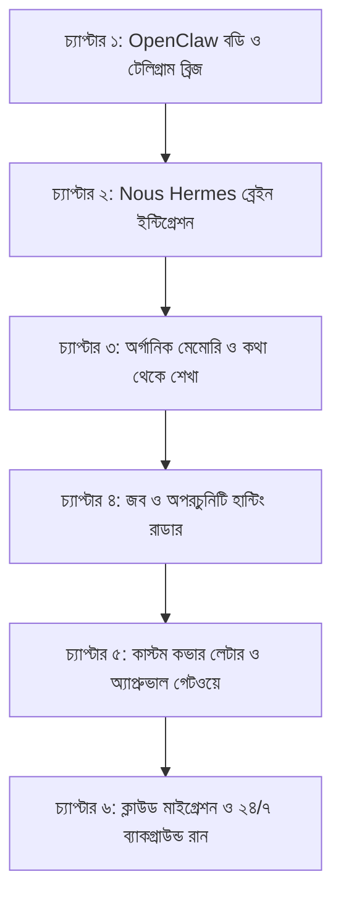

# 🦅 Special Agent: OpenClaw (Body) + Nous Hermes (Brain)
> **পার্সোনাল এআই সহকারী ও ক্যারিয়ার হান্টিং ইঞ্জিন**  
> *অপারেটর: Jubayer*

---

## 🎯 মূল দর্শন ও আর্কিটেকচার (Core Philosophy)

এই প্রজেক্টের লক্ষ্য কোনো সাধারণ রোবট তৈরি নয়। এটি একটি **বুদ্ধিমান পার্সোনাল এজেন্ট**:
1. **ওপেনক্ল (OpenClaw) বডি:** সিস্টেমের নিয়ন্ত্রণ, টেলিগ্রাম মোবাইল গেটওয়ে এবং অটোমেশন চালানোর শরীর।
2. **হার্মিস (Nous Hermes) ব্রেইন:** গভীর বিশ্লেষণ, পরিস্থিতি অনুযায়ী স্বতন্ত্র সিদ্ধান্ত এবং মানুষের মতো কাস্টম লেখালেখির মস্তিষ্ক।
3. **কথোপকথনের মাধ্যমে শিক্ষা (Organic Conversational Learning):** কোনো এককালীন ফর্ম পূরণের বদলে, দিনের পর দিন চ্যাটের মাধ্যমে এটি আপনার মানসিকতা, রুচি এবং কাজের ধরণ শিখে নেবে।
4. **ডলার আয় ও ক্যারিয়ার মিশন:** ২৪ ঘণ্টা রিমোট জব ও ক্লায়েন্টের সুযোগ খুঁজবে, হার্মিস দিয়ে কাস্টম আবেদনপত্র তৈরি করবে এবং আপনার অনুমতি সাপেক্ষে সরাসরি আবেদন পাঠাবে।

---

## 📚 ধাপে ধাপে বাস্তবায়নের চ্যাপ্টারসমূহ (Project Chapters)

---

### 🔹 চ্যাপ্টার ১: OpenClaw বডি ও টেলিগ্রাম গেটওয়ে (The Body & Remote Control)
* **লক্ষ্য:** পিসিতে এজেন্টের কোর গেটওয়ে স্থাপন করা এবং `@Jubayer_agent_bot`-এর সাথে সংযোগ দেওয়া।
* **যাচাই (Verification):** আপনি আপনার মোবাইল থেকে টেলিগ্রামে "হাই" লিখলে পিসি থেকে সে রেসপন্স করবে।
* **স্ট্যাটাস:** [ ] প্রস্তুত করতে হবে

---

### 🔹 চ্যাপ্টার ২: Nous Hermes ৩ ব্রেইন ইন্টিগ্রেশন (The Brain)
* **লক্ষ্য:** এজেন্টের ভেতরে ফিক্সড টেমপ্লেটের পরিবর্তে Nous Hermes ৩-এর লাইভ রিজনিং এপিআই যুক্ত করা।
* **ফলাফল:** এজেন্ট প্রতিটি প্রশ্ন বা পরিস্থিতি নিজ বুদ্ধি দিয়ে গভীরভাবে বিশ্লেষণ করে উত্তর দেবে, কোনো বাঁধাধরা স্ক্রিপ্ট না।
* **স্ট্যাটাস:** [ ] প্রস্তুত করতে হবে

---

### 🔹 চ্যাপ্টার ৩: মেমোরি ও কথোপকথনের মাধ্যমে শেখা (Conversational Memory)
* **লক্ষ্য:** একটি ৩-স্তর বিশিষ্ট মেমোরি ডাটাবেজ (Episodic & Semantic Memory) সক্রিয় করা।
* **কাজের ধরণ:** 
  - আপনাকে জোর করে কোনো বায়োডাটা লিখতে হবে না।
  - আপনি চ্যাটে যখনই কোনো নির্দেশ দেবেন (যেমন: *"আমি এই ধরণের ক্লায়েন্ট পছন্দ করি না"* বা *"আমার রেট অমুক"*), সে তা সাথে সাথে নিজের ডায়রিতে লিখে রাখবে এবং ভবিষ্যতে কখনো ভুলবে না।
* **স্ট্যাটাস:** [ ] প্রস্তুত করতে হবে

---

### 🔹 চ্যাপ্টার ৪: জব ও অপরচুনিটি হান্টিং রাডার (Opportunity Radar)
* **লক্ষ্য:** গ্লোবাল রিমোট জব বোর্ড (RemoteOK, WeWorkRemotely) এবং ফ্রিল্যান্স ফিড ট্র্যাক করা।
* **কাজের ধরণ:** 
  - যেসব জবে ফুল স্ট্যাক, পাইথন, রিয়্যাক্ট, ওয়ার্ডপ্রেস বা শপিফাই চাওয়া হয়েছে, সেগুলো স্বয়ংক্রিয়ভাবে ফিল্টার করে নিয়ে আসবে।
  - ভুয়া বা অপ্রাসঙ্গিক পোস্টগুলো স্বয়ংক্রিয়ভাবে বাতিল করবে।
* **স্ট্যাটাস:** [ ] প্রস্তুত করতে হবে

---

### 🔹 চ্যাপ্টার ৫: কাস্টম কভার লেটার ও হিউম্যান-ইন-দ্য-লুপ গেটওয়ে (Smart Outreach)
* **লক্ষ্য:** হার্মিস ব্রেইন দিয়ে প্রতিটি জবের নির্দিষ্ট রিকোয়ারমেন্ট অনুযায়ী ইউনিক কভার লেটার প্রস্তুত করা।
* **অনুমোদন মেকানিজম:**
  - তৈরি করা ড্রাফট ও চাকরির বিবরণ আপনার টেলিগ্রামে পাঠাবে।
  - নিচে বাটন থাকবে: `[ ✅ অনুমোদন ও ইমেইল পাঠাও ]` এবং `[ ❌ বাতিল ]`।
  - আপনি বাটন চাপলে তবেই আপনার জিমেইল থেকে আবেদনপত্র যাবে, এর আগে নয়।
* **স্ট্যাটাস:** [ ] প্রস্তুত করতে হবে

---

### 🔹 চ্যাপ্টার ৬: ক্লাউড ডিপ্লয়মেন্ট (24/7 Cloud Autonomy)
* **লক্ষ্য:** লোকাল পিসির ওপর নির্ভরতা পুরোপুরি দূর করা।
* **ফলাফল:** সম্পূর্ণ প্রজেক্টটি ২৪ ঘণ্টা ক্লাউড সার্ভারে (যেমন Render/Railway/VPS) রাখা হবে—যাতে আপনার কম্পিউটার বন্ধ থাকলেও সিস্টেম বন্ধ না হয় এবং মোবাইলে অ্যালার্ট আসতে থাকে।
* **স্ট্যাটাস:** [ ] শেষ ধাপ
